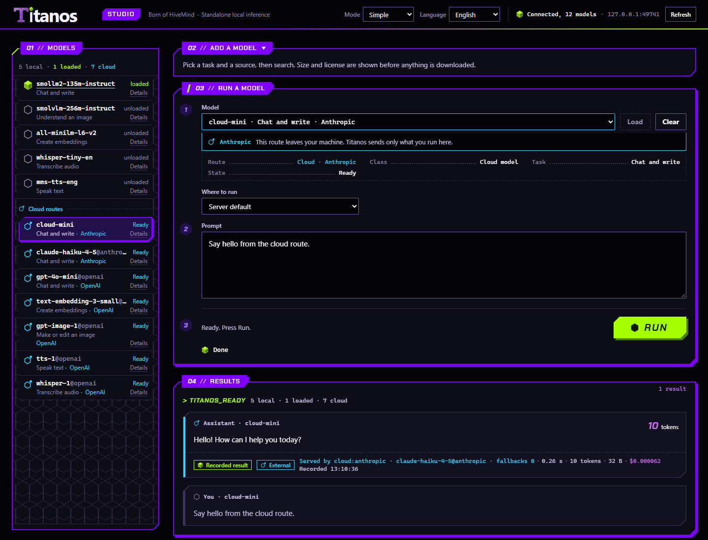
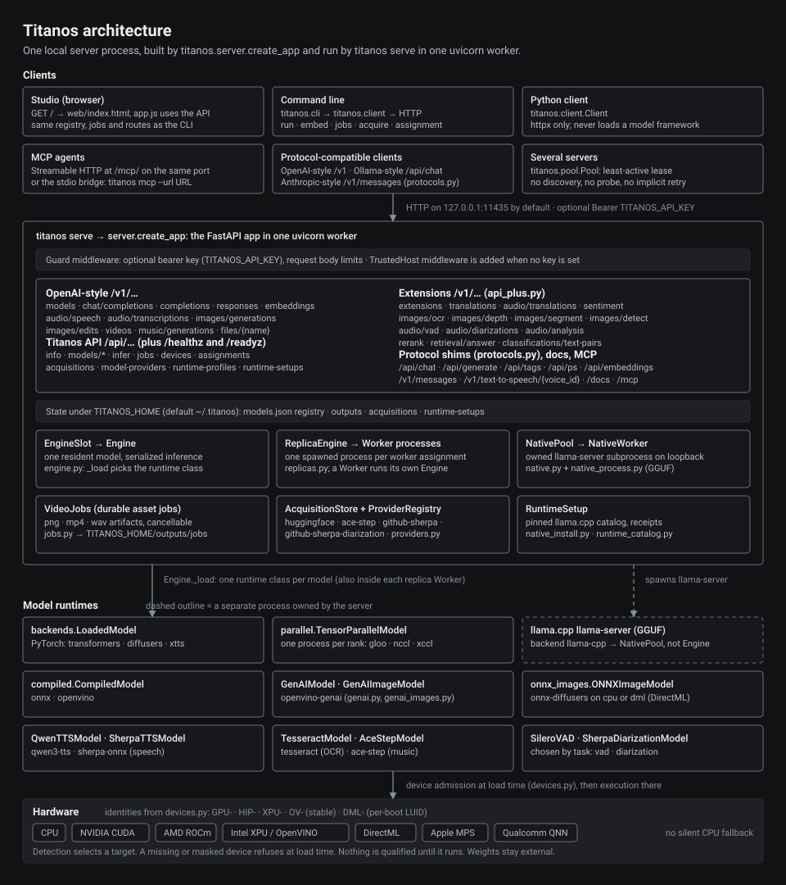
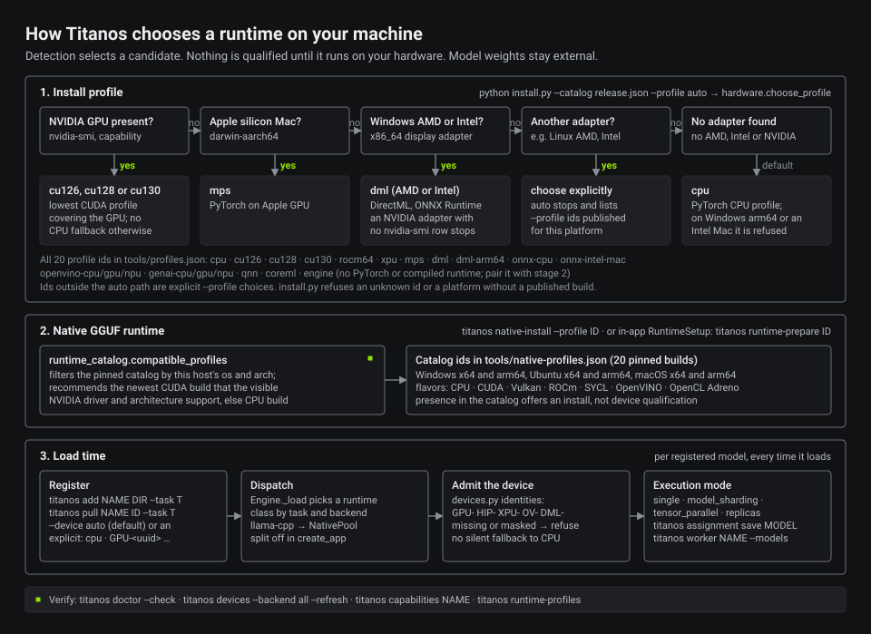

# Titanos

A standalone, local-first multimodal inference engine for people and agents.

Titanos serves models that live on your own disk through one consistent contract: an OpenAI-compatible HTTP API, a typed [MCP](docs/MCP.md) server, a CLI, a Python client and a browser workspace called Titanos Studio. Chat, vision, embeddings, reranking, speech, transcription, images, video and more share one registry, one model lifecycle, one job queue and one asset store. Weights stay outside the application, inference never downloads anything, and there is no account, router or cloud dependency. An optional [cloud broker](docs/BROKER.md), off by default, can route chosen requests to cloud providers you configure.

Titanos began as a standalone implementation of ideas from the HiveMind project; HiveMind is not required.

[Quick start](#quick-start) · [Pick your hardware](#pick-your-hardware) · [Talk to it](#talk-to-it) · [Models](#models) · [Status](#project-status-and-evidence) · [Documentation](#documentation) · [Contributing](#contributing-security-and-license)

> **Where it stands.** Version `0.5.30`. A release carries the wheel, the source distribution and the install catalog with checksums; compiled application bundles are not release assets. Real models have run through Titanos on Linux and Windows x64 CPU, Windows ARM64 CPU, Intel Mac CPU, NVIDIA CUDA (Turing, Ada and Blackwell), Intel OpenVINO (Arc GPU, integrated GPU and NPU), PyTorch XPU (Arc GPUs on Windows), Windows DirectML, Qualcomm QNN and Apple MPS. Other accelerator paths are catalogued and selectable but have not been executed on hardware yet. [STATUS.md](STATUS.md) and the [capability matrix](docs/CAPABILITY_MATRIX.md) say which is which, per model and per platform. A declared adapter is not proof for every checkpoint or device.

## What it does today

| Modality | Task names | Routes and tools | Runtimes |
|---|---|---|---|
| Chat and vision-language | `chat`, `vision` | `/v1/chat/completions`, `/v1/completions`, `/v1/responses`; Ollama `/api/chat`, `/api/generate`; Anthropic `/v1/messages`; MCP `chat`, `complete`, `responses`; `titanos run` | Transformers; llama.cpp GGUF (function tools, structured JSON output); OpenVINO GenAI for prepared LLM directories |
| Embeddings, reranking, retrieval, text pairs | `embeddings`, `rerank`, `pair-classification` | `/v1/embeddings`, `/v1/rerank`, `/v1/retrieval/answer`, `/v1/classifications/text-pairs`; MCP `embed`, `rerank`, `retrieval_answer`, `classify_pairs` | Transformers; prepared ONNX Runtime and OpenVINO graphs |
| Speech and audio | `speech`, `transcription`, `vad`, `diarization` | `/v1/audio/speech`, `/v1/audio/transcriptions`, `/v1/audio/translations`, `/v1/audio/vad`, `/v1/audio/diarizations`, `/v1/audio/analysis`; ElevenLabs-style `/v1/text-to-speech/{voice_id}`; MCP `speak`, `transcribe`, `translate_audio`, `vad`, `diarize`, `analyze_audio` | Whisper-family ASR; Silero VAD; Sherpa-ONNX speech and diarization; Qwen3-TTS and XTTS as optional extras |
| Text translation and sentiment | `translation`, `sentiment` | `/v1/translations`, `/v1/sentiment`, `/v1/sentiment/compose`; MCP `translate`, `sentiment`, `compose_sentiment` | Transformers |
| Images | `image`, `image-to-text`, `object-detection`, `depth-estimation`, `image-segmentation` | `/v1/images/generations`, `/v1/images/edits`, `/v1/images/ocr`, `/v1/images/detect`, `/v1/images/depth`, `/v1/images/segment`; MCP `generate_image`, `edit_image`, `estimate_depth`, `segment_image`, `extension_infer` | Diffusers; OpenVINO GenAI; ONNX (including DirectML); Tesseract |
| Video and music (asynchronous jobs) | `video`, `music` | `/v1/videos`, `/v1/videos/generations`, `/v1/music/generations`, `/api/jobs`; MCP `generate_video`, `submit_job`, `get_job`, `read_artifact` | Diffusers video (a trained image-to-video run is recorded); the ACE-Step music path exists in source; one 10-second instrumental has completed through a private Windows x64 candidate on one NVIDIA GPU (E-107 in the capability matrix), an engine result and not a quality claim |
| Raw graphs | `tensor` | `/api/infer` (list or base64 tensors; uint8 `cast`/`normalize` inputs and `output_views` in [INTERFACES](docs/INTERFACES.md)); MCP `infer_tensor` | Prepared ONNX and OpenVINO graphs |

Nineteen task types and twelve backend names are declared in the CLI (`titanos add --help`). The generated [route contract matrix](docs/ROUTE_CONTRACT_MATRIX.md) binds every HTTP operation to its request and response models, MCP tools, CLI subcommands and Python client methods.

## Quick start

You need Python 3.11 to 3.13, a virtual environment and network access for the one-time model download. This CPU recipe is the recorded dependency baseline and works on x86_64 Linux and Windows; GPUs, NPUs and Macs are in [Pick your hardware](#pick-your-hardware).

```sh
git clone https://github.com/pgoode41/Titanos.git
cd Titanos
python3 -m venv .venv                    # Windows: python -m venv .venv
source .venv/bin/activate                 # Windows PowerShell: .venv\Scripts\Activate.ps1
python -m pip install torch==2.8.0 torchvision==0.23.0 --index-url https://download.pytorch.org/whl/cpu
python -m pip install -e ".[models]"
titanos init
titanos pull chat HuggingFaceTB/SmolLM2-135M-Instruct --task chat
titanos doctor --check
titanos serve --open
```

Debian and Ubuntu need `sudo apt install python3-venv` once; inside the activated environment `python` is the venv interpreter on every platform. Install the PyTorch wheel for your hardware before the `[models]` extra; the extra accepts any torch 2.8 to 2.12 and would otherwise pull the newest build from PyPI. `serve --open` starts the server on `http://127.0.0.1:11435` and opens Titanos Studio in your browser; running `titanos` with no arguments does the same. In a second terminal with the same environment active:

```sh
titanos run chat "Explain local inference in two sentences." --stream
```

What just happened: `init` created the registry at `~/.titanos/models.json`; `pull` downloaded the repository into `~/.titanos/models/` and registered it under the name `chat`; `doctor --check` ran a small neural network on the selected device and printed the hardware it found; `serve` exposed the HTTP API, Studio, the API reference at `/docs` and MCP at `/mcp/` on one port. Set `TITANOS_HOME` to move everything. SmolLM2-135M is a setup check, not a quality baseline; register a model you actually want next.

### Lighter start: GGUF models without PyTorch

```sh
python -m pip install -e .
titanos native-install --profile ubuntu-x64        # pick your platform from the list below
titanos init
titanos pull agent Qwen/Qwen2.5-0.5B-Instruct-GGUF --revision 9217f5db79a29953eb74d5343926648285ec7e67 --task chat --backend llama-cpp --model-file qwen2.5-0.5b-instruct-q4_k_m.gguf --device cpu --anonymous
titanos doctor --backend engine
titanos serve
```

`native-install` downloads a checksum-pinned llama.cpp `b10809` server for your platform from the catalog packaged with Titanos; `pull` fetches only the chosen quantization. Profiles: `ubuntu-x64`, `ubuntu-arm64`, `ubuntu-vulkan-x64`, `ubuntu-vulkan-arm64`, `ubuntu-rocm-10.0-x64`, `ubuntu-sycl-fp16-x64`, `ubuntu-sycl-fp32-x64`, `ubuntu-openvino-2026.3.1-x64`, `win-cpu-x64`, `win-cpu-arm64`, `win-cuda-12.4-x64`, `win-cuda-13.3-x64`, `win-cuda-13.4-arm64`, `win-vulkan-x64`, `win-rocm-10.0-x64`, `win-sycl-x64`, `win-openvino-2026.3.1-x64`, `win-opencl-adreno-arm64`, `macos-x64`, `macos-arm64`. A catalog entry is an installable runtime, not a device qualification. See [docs/NATIVE.md](docs/NATIVE.md).

## Pick your hardware

Swap the PyTorch line of the quick start for the row that matches your machine, then run the first check. Titanos never substitutes CPU for an accelerator you asked for; it fails with a message instead. **Recorded** means a real model ran on that path and the result is written down in the [capability matrix](docs/CAPABILITY_MATRIX.md#hardware-scope); **candidate** means the runtime is catalogued and selectable but has not been executed on that hardware yet. Per-platform steps, expected `doctor` output and driver notes are in [docs/GETTING_STARTED.md](docs/GETTING_STARTED.md).

| Machine | Runtime install (inside the virtual environment) | First check | Today |
|---|---|---|---|
| x86_64 CPU, Linux or Windows | `pip install torch==2.8.0 torchvision==0.23.0 --index-url https://download.pytorch.org/whl/cpu`, then `pip install -e ".[models]"` | `titanos doctor --check` | Recorded on Linux and Windows x64 |
| ARM64 CPU, Linux | the same CPU line | the same | Candidate (upstream wheels exist); Windows ARM64 has no catalogued PyTorch profile, see the Snapdragon rows below |
| NVIDIA GPU, Linux or Windows x64 | `--index-url https://download.pytorch.org/whl/cu126` for compute capability 5.0 to 9.x, or `.../whl/cu128` for 7.0 to 12.x (Blackwell needs cu128), then `.[models]` | `titanos doctor --check --device cuda:0` | Recorded on Turing (RTX 2070 Max-Q, Windows; E-096), Ada (RTX 4090 on Linux, E-022 to E-024; RTX 3500 Ada on Windows through the released 0.5.1 bundle, E-002) and Blackwell (RTX PRO 6000 and RTX 5070, Windows); Maxwell, Pascal, Volta, Ampere and Hopper are catalog fits only |
| AMD GPU, Linux x64, ROCm 6.4 | `--index-url https://download.pytorch.org/whl/rocm6.4`, then `.[models]`; ROCm uses the `cuda:0` device namespace | `titanos doctor --check --device cuda:0` | Candidate |
| Intel GPU through PyTorch XPU, Linux or Windows x64 | `--index-url https://download.pytorch.org/whl/xpu`, then `.[models]` | `titanos doctor --check --device xpu:0` | Recorded on Windows x64 from source: Arc B580 (E-099) and Arc 130V (E-101) with torch 2.8.0+xpu, one instruct-pix2pix cell held at partial; Linux XPU is a candidate. XPU is not the Intel NPU |
| Intel CPU, Arc or integrated GPU, AI Boost NPU through OpenVINO, Linux or Windows x64 | `pip install -e ".[openvino]"` (`.[genai]` for prepared LLM directories) | `titanos doctor --backend openvino --device GPU --check` (or `CPU`, `NPU`) | Recorded on Arc B580/A770, Iris Xe and Intel NPU with prepared graphs |
| Any DirectX 12 GPU on Windows x64 through DirectML | `pip install -e ".[dml]"` | `titanos doctor --backend onnx --device dml --check` | Recorded on Radeon 840M, Iris Xe and RTX 3500 Ada; prepared ONNX graphs only |
| Windows on ARM (Snapdragon X): CPU | `pip install -e ".[onnx]"` for prepared ONNX graphs; for PyTorch models `pip install torch==2.9.1 torchvision==0.24.1 --index-url https://download.pytorch.org/whl/cpu` (the win_arm64 pair the recorded runs used on Python 3.12; 2.8.0 has no torchvision partner there), then `pip install -e ".[models]"` | `titanos doctor --backend onnx --device cpu --check` or `titanos doctor --check` | Recorded from source on the Snapdragon X laptop, 31 of 31 executed rows (E-102, E-103): Transformers and Diffusers models, prepared ONNX graphs, Sherpa, Tesseract and GGUF (`win-cpu-arm64`); no catalogued `cpu` installer profile for this platform |
| Windows on ARM (Snapdragon): Adreno GPU or Hexagon NPU | `pip install -e ".[dml-arm64]"` for the GPU; `pip install onnxruntime==1.27.0 onnxruntime-qnn==2.6.0` then `pip install -e ".[compiled]"` for the NPU | `titanos doctor --backend onnx --device dml --check` or `--device qnn` | Recorded prepared classifier and embedding graphs on both |
| Apple silicon Mac | `pip install torch==2.8.0 torchvision==0.23.0` (PyPI wheels), then `pip install -e ".[models]"` | `titanos doctor --check --device mps` | Recorded CPU and MPS runs (M4); MPS is the GPU, not the Neural Engine |
| Intel Mac, macOS 13 or later | `pip install onnxruntime==1.23.2`, then `pip install -e ".[compiled]"` | `titanos doctor --backend onnx --device cpu --check` | Recorded from source on an Intel Core i9 MacBook Pro (macOS x86_64), 10 of 10 executed cells (E-094, E-097, E-098, E-101): prepared ONNX embeddings, VAD and tensor graphs with this install; Sherpa speech and diarization, Tesseract OCR and GGUF chat through their own runtimes. No PyTorch wheel exists for this platform, so Transformers and Diffusers models do not apply; no native package yet (HW-15) |
| GGUF models on any of the above | `pip install -e .`, then `titanos native-install --profile <id>` | `titanos doctor --backend engine` | Recorded on Linux x64 CPU (E-036), Windows x64 CPU and CUDA (E-069, E-092), Windows ARM64 CPU (E-102), macOS x86_64 CPU (E-097) and the Iris Xe through the SYCL build (E-101); the same SYCL build fails at its first matmul on the Arc B580 and A770 (E-101, retained); other native profiles are candidates |

DirectML, OpenVINO, QNN and Core ML run prepared graphs, not arbitrary PyTorch checkpoints. On an install without PyTorch the quick-start SmolLM2 pull registers a model that cannot load: pull a repository that ships a graph (`titanos pull embed OWNER/ONNX-MODEL --task embeddings --backend onnx --graph onnx/model.onnx --device cpu`), or export one on a PyTorch machine from a registered Transformers embedding model (`titanos prepare my-embedder my-embedder-onnx --backend onnx --output DIR`), copy the directory over and register it with `titanos add embed DIR --task embeddings --backend onnx --device cpu` (or `--device dml`, `qnn`, `coreml`); GGUF chat through `native-install` needs no PyTorch either ([docs/GETTING_STARTED.md](docs/GETTING_STARTED.md#the-same-five-steps-on-every-platform)). CUDA registrations are pinned to the GPU UUID, so a card that disappears causes an error, never a silent substitution; mixed machines (for example one Pascal and one Blackwell card) need separate environments per card. The release installer (`python install.py --catalog <release.json> --profile auto`) picks a profile from the detected hardware, but it needs a published release catalog with a plain `X.Y.Z` version; none is published yet, so install with pip from this checkout. Details: [docs/HARDWARE.md](docs/HARDWARE.md), [docs/DEVICES.md](docs/DEVICES.md), [docs/DIRECTML.md](docs/DIRECTML.md), [docs/MULTIGPU.md](docs/MULTIGPU.md).

## Talk to it

One server, five ways in; all share the same registry, limits, jobs and artifacts. The full map is [docs/INTERFACES.md](docs/INTERFACES.md).

| Interface | Where | Notes |
|---|---|---|
| HTTP API | `http://127.0.0.1:11435/v1/...` (OpenAI-compatible) and `/api/...` (Titanos control) | Ollama, Anthropic Messages and ElevenLabs shapes too; `/openapi.json` schema, `/docs` reference served from the package; see [protocol compatibility](docs/PROTOCOL_COMPATIBILITY.md) and [extended operations](docs/API_PLUS.md) |
| MCP | Streamable HTTP at `/mcp/`; stdio through `titanos mcp` | Official Python SDK (`mcp==2.2.0`), typed tools, resources and prompts; see [docs/MCP.md](docs/MCP.md) |
| CLI | `titanos <command>`; `titanos --help` | Setup, lifecycle, inference, jobs, model acquisition and device assignment |
| Python | `from titanos.client import Client` | Synchronous httpx client; `titanos.pool.Pool` for several servers ([docs/MULTIHOST_CLIENT.md](docs/MULTIHOST_CLIENT.md)) |
| Studio | `http://127.0.0.1:11435/` (`titanos serve --open`) | Simple and Advanced modes; English, Spanish, Japanese and Simplified Chinese; see [docs/STUDIO_USAGE.md](docs/STUDIO_USAGE.md) |

### HTTP

```sh
curl -s http://127.0.0.1:11435/v1/chat/completions \
  -H "Content-Type: application/json" \
  -d '{"model":"chat","messages":[{"role":"user","content":"Hello"}]}'
```

Without `TITANOS_API_KEY` and without any minted key the server answers only on loopback and accepts only `localhost` and `127.0.0.1` as the host name (a bracketed IPv6 host such as `[::1]` is answered 400 `Invalid host header`, so serving on `::1` needs the key). Once a key exists, every route except health, the Studio shell and the API reference requires `Authorization: Bearer <key>` (the Anthropic, ElevenLabs and Gemini routes also accept their own `x-api-key`, `xi-api-key` and `x-goog-api-key` headers). The official OpenAI Python SDK works against `http://127.0.0.1:11435/v1`; the repository's own SDK checks use it.

### MCP

Streamable HTTP is at `http://127.0.0.1:11435/mcp/`, on the same port and behind the same key as the API. For desktop hosts that launch stdio servers:

```json
{"command": "titanos", "args": ["mcp", "--transport", "stdio", "--url", "http://127.0.0.1:11435"]}
```

The stdio process talks to your running server; it does not load a second copy of your models.

### CLI

```sh
titanos models                        # what the running server has registered
titanos load chat && titanos ps       # explicit residency
titanos embed my-embedder "one text" "another text"
titanos jobs list
titanos settings --json               # effective configuration; never prints keys
titanos <command> --help
```

### Python

```python
from titanos.client import Client

with Client("http://127.0.0.1:11435") as client:          # api_key=... or TITANOS_API_KEY
    reply = client.chat("chat", [{"role": "user", "content": "Hello"}])
    print(reply["choices"][0]["message"]["content"])
    for event in client.chat("chat", [{"role": "user", "content": "Stream this"}], stream=True):
        delta = event["choices"][0]["delta"].get("content")
        if delta:
            print(delta, end="", flush=True)
    vectors = client.embeddings("my-embedder", ["one text", "another text"])
```

### Studio

Titanos Studio lives at `http://127.0.0.1:11435/`. Simple mode keeps the essentials: select a model, type a prompt, press Run; image, audio, music and video runs are listed under Jobs. Advanced adds local registration, generation controls, diagnostics and device assignments. Studio uses the same routes as everything else and makes no external requests.



## Models

Weights are yours and stay outside Titanos. Register what you have or pull what you need:

```sh
titanos add my-llm /path/to/model --task chat                 # an existing local directory
titanos pull my-embedder sentence-transformers/all-MiniLM-L6-v2 --task embeddings
titanos search --library openvino --limit 20
titanos inspect OWNER/REPO
titanos list
titanos remove my-llm                                         # weights stay on disk
```

A model needs its matching configuration, tokenizer or processor and a supported adapter; an arbitrary weight file is not automatically usable. `--allow-pickle` and `--trust-remote-code` are explicit local opt-ins; the network registration route refuses them. Through the running server, `titanos providers`, `discover`, `acquire` and `acquisitions` give task-first discovery and durable, resumable downloads with license acceptance. Guides: [model adapters](docs/MODEL_ADAPTERS.md), [model providers](docs/MODEL_PROVIDERS.md), [managed GGUF runtime](docs/NATIVE.md), [configuration](docs/CONFIGURATION.md), [option parity with Ollama and llama.cpp](docs/OPTION_PARITY.md).

## Configuration and security defaults

- Binds `127.0.0.1:11435`. Binding to any other interface requires `TITANOS_API_KEY` (or an active admin key); Titanos refuses to start otherwise. For TLS set `TITANOS_TLS_CERTFILE` and `TITANOS_TLS_KEYFILE`, or run a TLS terminator on the same host with `TITANOS_BEHIND_TLS_PROXY=true` and a loopback bind; forwarded headers are not trusted otherwise.
- Keys: `TITANOS_API_KEY` is the bootstrap key and grants everything. `titanos keys create` mints scoped keys (`tk_...`) with scopes, model constraints, rate limits, budgets and an expiry; jobs, artifacts and stored responses are visible only to the key that created them. Once any key exists the server stays keyed until an offline `titanos keys reset --keyless`. This is scoped access for one operator's clients, not hardened multi-tenant isolation ([docs/BROKER_SECURITY.md](docs/BROKER_SECURITY.md#inbound-keys)).
- Cloud is off by default. The optional [cloud broker](docs/BROKER.md) sends a request to a provider only after the operator configures an upstream with a credential, enables a cloud policy and lets the caller use it; every answer then says where it ran (`X-Titanos-Served-By`). Roles for orchestrated deployments (for example under HiveMind) are in [docs/TOPOLOGY_ROLES.md](docs/TOPOLOGY_ROLES.md).
- Everything is an environment variable or a flag: `titanos settings --json` prints the effective values and their names. `TITANOS_HOME` (default `~/.titanos`) holds the registry, pulled models, generated assets and acquisitions; `TITANOS_PORT`, `TITANOS_THREADS`, `TITANOS_DEFAULT_MAX_TOKENS`, queue sizes, media limits and timeouts are in [docs/CONFIGURATION.md](docs/CONFIGURATION.md).
- Generation options resolve in order: the request field, the model's registered defaults, the server's environment defaults, then the adapter's own defaults. Configured limits and the model's physical context still apply.

[SECURITY.md](SECURITY.md) states the security model and how to report a vulnerability.

## Docker

```sh
docker build -t titanos .
docker run --rm -v titanos-home:/var/lib/titanos titanos init
docker run --rm -e TITANOS_API_KEY=change-me -p 127.0.0.1:11435:11435 -v titanos-home:/var/lib/titanos titanos
```

The image serves on port 11435. Inside a container the server has to bind beyond loopback to be reachable, and the CLI requires `TITANOS_API_KEY` for that; without the variable the container exits with `Set TITANOS_API_KEY before binding to a network interface`. The named volume `titanos-home` is mounted at the image's `TITANOS_HOME`, `/var/lib/titanos` (the `ENV` and `VOLUME` lines in the [Dockerfile](Dockerfile)), so the registry and pulled weights outlive the container. `serve` reads the registry before it binds and refuses to start until `init` has created it there (`titanos: No registry at /var/lib/titanos/models.json. Run 'titanos init' first.`); `pull` through the same volume registers a model ([docs/GETTING_STARTED.md](docs/GETTING_STARTED.md#docker-linux-cpu-image)). No recorded run has used the image yet.

## Native application bundles

No binary release is published yet. Releases are drafted from an existing version tag by `.github/workflows/release.yml` (manual dispatch) and carry a wheel, a source distribution, the release catalog with its installer, and checksums, not a compiled bundle; Titanos is not on PyPI. `tools/build_binary.py` builds a portable application directory (embedded CPython, the selected runtimes, Studio, MCP, licenses and an SBOM) on the target platform and validates it from a clean data directory. Build Windows on Windows, Linux on Linux, macOS on macOS. Model weights stay external. See [docs/DISTRIBUTION.md](docs/DISTRIBUTION.md) and [docs/RELEASING.md](docs/RELEASING.md).

## Project status and evidence

Titanos records what actually ran, on which hardware, with which model, and keeps failures as failures. Results are recorded in three layers: **ENGINE_CONTRACT** (the engine executed the intended modality with valid output, declared controls, protocol and lifecycle), **MODEL_QUALITY** (how good the output was) and **HUMAN_PRESENTATION** (demonstration and human review). A coherent wrong answer is a model-quality observation, not an engine failure.

| Page | What it answers |
|---|---|
| [STATUS.md](STATUS.md) | What works, what is partial, what is not implemented, in plain language |
| [docs/CAPABILITY_MATRIX.md](docs/CAPABILITY_MATRIX.md) | Per-family and per-hardware rows with evidence IDs |
| [docs/PROGRESS.md](docs/PROGRESS.md) | The 95-row acceptance ledger (machine form: [docs/progress.json](docs/progress.json)) |
| [docs/EXECUTION_MATRIX.md](docs/EXECUTION_MATRIX.md) | Every model against every platform slot, one state per cell (generated) |
| [docs/ROSTER.md](docs/ROSTER.md) | The named packages, platforms, models and workloads the records bind (generated) |

Not implemented: training, hardened multi-tenant isolation, automatic failover or model sharding across Titanos machines. Within one server the cloud broker's virtual models can fall back between configured local and cloud targets before the first byte ([docs/BROKER.md](docs/BROKER.md)). Priorities are broad, understandable local inference before peak throughput: useful CPU, established CUDA and Intel OpenVINO paths first, then other hardware and modalities through explicit model and backend qualification.

## Architecture

`titanos serve` runs one FastAPI process on uvicorn. A guard middleware enforces the bearer key and body limits (and, in keyless mode, loopback-only host names). The process owns the model registry at `TITANOS_HOME/models.json`, an engine that holds one resident model per process (or worker processes for replicas and multi-GPU modes), a pool of owned llama.cpp server subprocesses for GGUF models, durable asset jobs, model acquisitions and native runtime setup. Runtimes execute on CPU, NVIDIA CUDA, AMD ROCm, Intel XPU or OpenVINO, DirectML, Apple MPS or Qualcomm QNN devices identified by stable IDs.





## Documentation

Start at the [documentation index](docs/README.md). Most-used pages:

| Page | Use it for |
|---|---|
| [docs/GETTING_STARTED.md](docs/GETTING_STARTED.md) | Per-platform install, expected `doctor` output, what is qualified versus candidate |
| [docs/INTERFACES.md](docs/INTERFACES.md) | Every HTTP route, MCP tool, CLI subcommand and client method with a one-line purpose |
| [docs/CONFIGURATION.md](docs/CONFIGURATION.md) | Environment variables, per-model defaults, limits, bind failures |
| [docs/MCP.md](docs/MCP.md) | Host configuration, tools, resources, prompts, embedding in an ASGI app |
| [docs/BROKER.md](docs/BROKER.md) | The optional cloud broker: providers, routing, keys and budgets, provenance, what leaves the host; security in [docs/BROKER_SECURITY.md](docs/BROKER_SECURITY.md), roles in [docs/TOPOLOGY_ROLES.md](docs/TOPOLOGY_ROLES.md) |
| [docs/MODEL_PROVIDERS.md](docs/MODEL_PROVIDERS.md) | Find, inspect, pull and register a model, from Studio or the CLI |
| [docs/MODEL_ADAPTERS.md](docs/MODEL_ADAPTERS.md) | Which files and runtime a checkpoint needs before it can load |
| [docs/STUDIO_USAGE.md](docs/STUDIO_USAGE.md) | The browser interface, Simple and Advanced modes, languages |
| [docs/PROTOCOL_COMPATIBILITY.md](docs/PROTOCOL_COMPATIBILITY.md) | Per-field differences from the OpenAI, Ollama, Anthropic and ElevenLabs shapes |
| [docs/HARDWARE.md](docs/HARDWARE.md) | Runtime profiles, the PyTorch and compiled matrix, installer behaviour |
| [docs/OPERATIONS.md](docs/OPERATIONS.md) | Run `serve` as a service (`titanos service`), upgrade, logs, readiness and metrics routes, HiveMind registration, backups of `TITANOS_HOME` |
| [docs/PERFORMANCE.md](docs/PERFORMANCE.md) | Observed throughput and latency per path, the serving defaults that follow from it, and the knobs for a loaded server |
| [tests/README.md](tests/README.md) | How the checks are organised and which ones gate a release |

## Contributing, security and license

Issues and pull requests are welcome. [CONTRIBUTING.md](CONTRIBUTING.md) lists the checks that must pass and the conventions: Developer Certificate of Origin sign-off, neutral example paths only, generated documents regenerated rather than edited. Report vulnerabilities privately as described in [SECURITY.md](SECURITY.md); community expectations are in [CODE_OF_CONDUCT.md](CODE_OF_CONDUCT.md).

Titanos source is licensed under [Apache-2.0](LICENSE); see [NOTICE](NOTICE) for attributions. Dependencies, native components and model weights keep their own licenses and redistribution terms.
